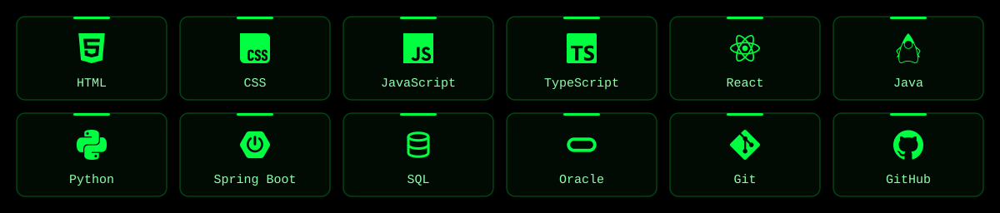

  

# Guilherme Novaes 👨🏻‍💻

`Desenvolvedor FullStack` · `Estudante de ADS na FIAP`

  
  

---

## `> cat sobre.txt`

Olá! Me chamo Guilherme, sou estudante de Análise e Desenvolvimento de Sistemas na FIAP e apaixonado por tecnologia, programação e desenvolvimento de soluções.

Minha jornada é movida pela curiosidade de entender como as coisas funcionam e pela vontade de transformar problemas em soluções através do código.

Tenho conhecimentos em desenvolvimento web, programação, banco de dados e desenvolvimento de sistemas, trabalhando com Java, Python, JavaScript, TypeScript, React, HTML, CSS, SQL e Oracle. Também utilizo Git e GitHub para versionamento e organização dos meus projetos.

Meu objetivo é crescer profissionalmente como desenvolvedor, adquirir experiência em projetos reais e contribuir para a criação de soluções eficientes e inovadoras.

---

## `> ls ./tech-stack`

  

---

## `> git log --stats`

  
  

  

## `> tail -f activity.log`

  

  

🕷️ Cards atualizados automaticamente todos os dias.

