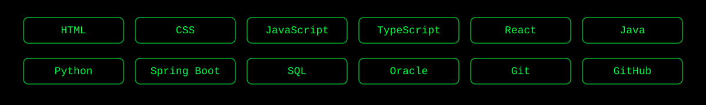
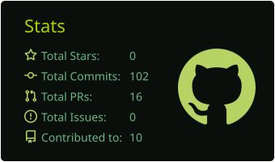
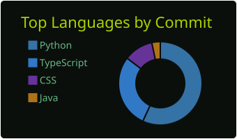

  

# Guilherme Novaes 👨🏻‍💻

`Desenvolvedor FullStack` · `Estudante de ADS na FIAP`

  
  

---

## `> cat sobre.txt`

Olá! Eu sou **Guilherme Novaes**, estudante de **Análise e Desenvolvimento de Sistemas na FIAP** e apaixonado por tecnologia, programação e desenvolvimento de soluções.

Minha jornada na área de tecnologia é movida pela curiosidade de entender **como as coisas funcionam** e pela vontade de transformar problemas em soluções através do código.

Tenho conhecimentos em **desenvolvimento web, programação, banco de dados e desenvolvimento de sistemas**, trabalhando com tecnologias como **Java, Python, JavaScript, TypeScript, React, HTML, CSS, SQL e Oracle**. Também utilizo **Git e GitHub** para versionamento e organização dos meus projetos.

🎯 Meu objetivo é crescer profissionalmente como desenvolvedor, adquirir experiência em projetos reais e contribuir para a criação de soluções eficientes e inovadoras.

---

## `> ls ./tech-stack`

  

---

## `> ls ./projetos`

### 🦯 Bengala Inteligente
`Tecnologia Assistiva` · `Acessibilidade` · `Inovação`

Dispositivo que transforma uma bengala convencional em uma ferramenta tecnológica de auxílio à locomoção para pessoas com deficiência visual. Sensores detectam obstáculos próximos, e o usuário é alertado por sinal sonoro e vibração.

- 🎯 **Objetivo:** criar uma solução de baixo custo e aplicação prática, unindo eletrônica e software para aumentar a autonomia e a segurança na locomoção.
- ⚙️ **Funcionalidades:** detecção de obstáculos por sensores, alerta sonoro, alerta por vibração.
- 🧩 **Desafios:** detecção eficiente de obstáculos, definição da distância de alerta, integração dos sensores e componentes, foco na experiência do usuário.

---

### 🌱 ClimaPlantio
`FIAP Global Solution 2026/1` · `Grupo Dome`

Sistema de monitoramento agrícola que conecta dados de satélite (NASA/INPE) a produtores rurais, por meio de cálculos de NDVI e alertas climáticos.

- 🎯 **Objetivo:** levar informação de satélite de forma simples para apoiar decisões no campo.
- ⚙️ **Funcionalidades:** cálculo de NDVI, alertas climáticos, integração com dados da NASA e do INPE.
- 📦 **Entregas:** aplicação Python, sistema Java, site (demo), documentação e apresentação em PowerPoint.
- 🏗️ **Arquitetura:** CLI em Python, back-end Java em DDD (`br.com.fiap`) e front-end em HTML, CSS e JS.

---

### 🌿 Soul Up — Avatar Inteligente
`FIAP Challenge Next 2026` · `Grupo Dome`

Plataforma de engajamento sustentável com um avatar inteligente que acompanha o usuário em sua jornada. O projeto é multidisciplinar e reúne back-end, front-end, banco de dados e scripts em uma única solução.

- 🤖 **Avatar inteligente:** personagem personalizado que acompanha o usuário na plataforma.
- 🏆 **Gamificação:** pontos ECOA, Selos Verdes e créditos de carbono.
- ☕ **Back-end:** API RESTful em Java com Spring Boot e arquitetura DDD (Model, DAO, BO e Resource).
- ⚛️ **Front-end:** interface em React.
- 🗄️ **Banco de dados:** modelagem e script DDL em Oracle.
- 🐍 **Python:** módulo em Python da mesma solução.

---

## `> ./estudando --now`

  
  
  
  
  
  
  
  
  
  
  
  
  
  
  
  
  
  

---

## `> git log --stats`

  
  

  

## `> tail -f activity.log`

  

[ok] Cards atualizados automaticamente todos os dias.

