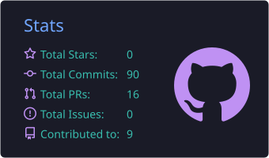

# 👨🏻‍💻 Guilherme Novaes

**`Desenvolvedor FullStack`**

Olá! Eu sou **Guilherme Novaes**, estudante de **Análise e Desenvolvimento de Sistemas na FIAP** e apaixonado por tecnologia, programação e desenvolvimento de soluções.

Minha jornada na área de tecnologia é movida pela curiosidade de entender **como as coisas funcionam** e pela vontade de transformar problemas em soluções através do código.

Tenho conhecimentos em **desenvolvimento web, programação, banco de dados e desenvolvimento de sistemas**, trabalhando com tecnologias como **Java, Python, JavaScript, TypeScript, React, HTML, CSS, SQL e Oracle**.

Também utilizo **Git e GitHub** para versionamento e organização dos meus projetos.

🎯 Meu objetivo é crescer profissionalmente como desenvolvedor, adquirir experiência em projetos reais e contribuir para a criação de soluções eficientes e inovadoras.

---

### 📊 Estatísticas

  
  

### 🔗 Conecte-se comigo

---

### 🤖 Linguagens e Tecnologias

 

---

### 💻 Tecnologias

#### 🎨 Front-end

* HTML5
* CSS3
* JavaScript
* TypeScript
* React

#### ⚙️ Back-end

* Java
* Python

#### 🗄️ Banco de Dados

* SQL
* Oracle

#### 🛠️ Ferramentas

* Git
* GitHub
* IntelliJ IDEA
* Visual Studio Code

---

### 🚀 Projetos

🦯 Bengala Inteligente — Tecnologia Assistiva

Dispositivo que transforma uma bengala convencional em ferramenta tecnológica de auxílio à locomoção para pessoas com deficiência visual. Utiliza sensores para detectar obstáculos próximos e alerta o usuário por meio de sinal sonoro e vibração, oferecendo diferentes formas de feedback.

Foco: Tecnologia Assistiva, Acessibilidade, Inovação, Sensores
Objetivo: Criar uma solução de baixo custo e aplicação prática, unindo eletrônica e software para aumentar autonomia e segurança na locomoção.
Principais desafios: detecção eficiente de obstáculos, definição de distância de alerta, integração de sensores/componentes, foco na experiência do usuário.
🌱 ClimaPlantio — FIAP Global Solution 2026/1

Sistema de monitoramento agrícola desenvolvido pelo Grupo Dome, conectando dados de satélite (NASA/INPE) a produtores rurais por meio de cálculos de NDVI e alertas climáticos.

Stack: CLI em Python, arquitetura Java (DDD — br.com.fiap), frontend em HTML/CSS/JS
Entregas: aplicação Python, sistema Java, site (demo), documentação e apresentação em PowerPoint
🌿 Soul Up — FIAP Challenge Next 2026

Sprint em Java com arquitetura DDD para a plataforma Soul Up, um sistema de engajamento sustentável.

Funcionalidades: pontos ECOA, Selos Verdes, créditos de carbono, avatar personalizado
Stack: Java (DDD)
---

### 📚 Atualmente estudando

  
  
  
  
  
  
  
  
  
  
  
  
  
  
  
  

